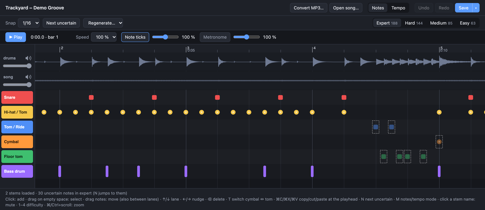

# Trackyard

Trackyard turns plain songs (MP3, WAV, OGG, FLAC) into playable drum charts for
[Beat-Train on the MPC Sample](https://github.com/drose030/beat-train-mpc-sample) and
Clone Hero.

Charting a song by hand takes hours: you place every kick, snare and hi-hat yourself
and line the tempo map up with the recording. Trackyard does a first pass for you. It
separates the drums, finds the beat grid and writes down the drum hits in four
difficulties. Its editor then shows where it was unsure, so you only fix what needs
fixing, and saves the song straight to the MPC's SD card.



Everything runs on your computer. Beat-Train on the MPC only plays the finished song
folder.

## What you need

- A **Mac with Apple Silicon** (Linux works too, on the CPU or with CUDA).
- **Python 3.11 or 3.12**, **ffmpeg** and [uv](https://docs.astral.sh/uv/). With
  Homebrew: `brew install python@3.12 ffmpeg uv`.
- About **1.2 GB** of disk space, mostly PyTorch and the models.

## Install

In the Trackyard folder:

```bash
uv venv -p 3.11 .venv
uv pip install -p .venv/bin/python -e .
```

The first conversion downloads about 160 MB of model weights once.

### Or: the app for Mac or Windows

The app holds Python, PyTorch and ffmpeg; nothing else needs installing. The first
conversion downloads the models once (about 160 MB). It isn't signed by a registered
developer yet, so the system warns the first time:

- **Mac** (Apple Silicon): `Trackyard-<version>-arm64.dmg`, about 300 MB. Open it and
  drag Trackyard to Applications. Start it once; macOS refuses and offers only Done or
  the bin, so click **Done**. Then go to **System Settings → Privacy & Security**, click
  **Open Anyway** at the bottom, and start it again. (Version 1.1.0 and older can only
  be opened by running `xattr -dr com.apple.quarantine /Applications/Trackyard.app` in
  the Terminal first.)
- **Windows** (64-bit): run `Trackyard-Setup-<version>.exe`; it installs for your user,
  without admin rights. If Windows says it protected your PC, click **More info → Run
  anyway**. Conversions run on the CPU, about 3–4 minutes per song. With an NVIDIA
  graphics card (GeForce GTX 16 / RTX 20 or newer, driver 580 or newer), the start
  screen offers **Download GPU support**: a one-time 2 GB download, after which songs
  convert on the graphics card.

To build the app yourself, see [docs/development.md](docs/development.md#the-desktop-app).

The app opens the editor in its own window; everything below works the same.

## Start

```bash
.venv/bin/trackyard edit
```

The editor opens in your browser (it runs locally, on 127.0.0.1:8765; `--port` and
`--no-browser` change that).
`trackyard edit "path/to/Song folder"` opens a song directly.

## Make a chart from an MP3

1. **Convert MP3…** and pick a song. Converting takes about 15–40 s on an M-series Mac;
   the new song opens when it's done.
2. Listen and fix what's off (see [The editor](#the-editor)). Notes Trackyard was
   unsure about are dimmed with a dashed outline; **N** jumps to the next one.
3. **Save** (⌘S). The first save of a new song asks for a folder and creates the song
   folder (`Artist - Title`) in it. Until then the song is only a draft, and converting
   the next song throws it away. An amber dot on Save means unsaved changes.
4. To play it on the MPC: **Save ▾ → Save as…** (⇧⌘S) and pick the SD card. The song
   lands in `BeatTrain/Songs/` there, and you keep editing the copy.

**Open song…** opens any song folder with a `song.ini` and `notes.mid` or `notes.chart`,
also Clone Hero songs from elsewhere.

## The editor

At the top: Convert MP3…, Open song…, the **Notes | Tempo** switch, Undo, Redo and
Save ▾. Below it are the tools of the current mode, then the transport bar with Play,
the position, speed, note ticks and metronome.

The timeline shows one waveform per audio stem (drums first) and six rows named and
coloured like Beat-Train's pads: Snare, Hi-hat / Tom, Tom / Ride, Cymbal, Floor tom,
Bass drum. Cymbals are drawn round, drums square.

### Notes

| Action | How |
|---|---|
| Add a note | Click an empty spot in a row (snaps to the chosen grid) |
| Select | Click a note (⇧ adds), drag a box on empty space, ⌘A for all; Esc clears |
| Move | Drag the selection, later/earlier and onto other rows |
| Nudge | ←/→ one grid step, ↑/↓ one row |
| Delete | ⌫ |
| Cymbal ↔ tom | T. Applies to every difficulty at that spot |
| Copy, cut, paste | ⌘C, ⌘X, ⌘V (pastes at the playhead), e.g. to repeat a bar in every chorus |
| Uncertain notes | N next, ⇧N back |
| Undo / redo | ⌘Z / ⇧⌘Z |
| Difficulty | 1–4 or the tabs on the right of the toolbar |
| Rebuild easier levels | **Regenerate…**: all of Hard, Medium and Easy, or one, from Expert |

Expert is the source: Hard, Medium and Easy are made from it by leaving notes out. So
fix Expert first, then regenerate the easier levels.

### Difficulty settings

On Hard, Medium or Easy a panel controls how that level is made from Expert. Every
change rebuilds the level right away (hand edits on it are replaced; ⌘Z undoes).

| Control | Effect |
|---|---|
| Preset | **MPC**: even steps for the pads. **Clone Hero**: like hand-made charts, no controls. **Custom**: anything you changed |
| Density | How much of Expert stays |
| Kick, Snare, Hi-hat, Toms, Cymbals | That instrument's share of its Expert notes; 0 turns it off. Downbeats and beats stay first, then eighths, then 16ths |
| Grid, Triplets | The finest note value kept |
| Hands, Notes at once | How many hand notes, and notes including the kick, may sound together |
| Shortest gap | Minimum time between two kick hits, and between two hand hits |

The note count, notes per second and share of Expert show on the right. The settings
are saved with the song. Hand-made charts and songs converted before these settings
existed start on Clone Hero.

### Tempo

If the grid drifts away from the music, switch to **Tempo** (or press M):

| Action | How |
|---|---|
| Fix the grid | Drag a beat line onto the hit in the drum waveform. It snaps to the nearest hit (hold Alt to place it freely) and becomes an anchor (◆); the tempo between anchors is recomputed |
| Remove an anchor | Double-click its line |
| Move the whole chart | Offset field or −5/+5 ms, or drag the first beat |
| Snap beat to hit | Pins the beat nearest the playhead onto the nearest drum hit |
| Revert tempo | Back to the tempo map as opened |

A dot under each beat shows how far the nearest drum hit is: green under 10 ms, amber
10–25 ms, red further, none when there's no hit nearby. Notes keep their place in the
bar, so they move with the grid.

### Playback

| Action | How |
|---|---|
| Play / pause | Space, or Play |
| Seek | Click the ruler; ←/→ one beat when nothing is selected; Home to the start |
| Speed | 100 %, 75 % or 50 %; the pitch stays |
| Scroll / zoom | Scroll / ⌘ or Ctrl + scroll |
| Hear the chart | Note ticks (on by default) and Metronome in the transport bar |
| Mute a stem | Click its name or speaker icon left of its waveform |
| Volumes | Each stem's slider under its name; note ticks and metronome in the transport bar |

### What saving changes

Only the drum notes, the difficulty settings, and the tempo map and offset when you
changed them. Guitar, vocals and everything else in a song from elsewhere stay as they
were. The first plain Save into an existing song keeps the original chart as
`notes.mid.orig` (or `notes.chart.orig`). 5-lane charts open read-only.

## Convert from the command line

For many songs at once:

```bash
.venv/bin/trackyard convert "Artist - Song.mp3" more/*.flac --sd /Volumes/MPC
```

Each song becomes a folder under `out/`:

| File | Contents |
|---|---|
| `notes.mid` | The drum chart in Expert, Hard, Medium and Easy, with the tempo map |
| `song.ini` | Name, artist, album, year and genre from the tags; length; drum difficulty |
| `drums.ogg` | The drums |
| `song.ogg` | Everything else |
| `album.jpg` / `.png` | The cover, when the file has one |
| `trackyard.json` | Trackyard's notes for the editor (confidences, settings) |

| Option | Effect |
|---|---|
| `--sd PATH` | Also copy to `PATH/BeatTrain/Songs/` (the MPC's SD card) |
| `--out DIR` | Where the song folders go (default `out`) |
| `--levels clone-hero` | Easier levels like hand-made Clone Hero charts. The default `mpc` makes even steps for the pads (about 65 / 45 / 25 % of Expert) |
| `--tempo auto\|half\|normal\|double` | Tempo relative to the detected beat. `auto` (default) doubles slow or 16th-note hi-hat songs like a charter would, and halves above 190 BPM |
| `--grid 16` | Snap to 1/16 at most (default 1/32) |
| `--no-triplets` | No triplets |
| `--expert-only` | Only Expert, no easier levels |
| `--single-audio` | One `song.ogg`, no separate drums |
| `--lane-rules` | Choose cymbal and tom rows with simple rules instead of the trained models |

## If something goes wrong

- **The first conversion is slow:** it downloads the models once and loads them; the
  next songs are quicker. The same file a second time takes only seconds.
- **"SD card path not found":** check the path after `--sd`, e.g. `/Volumes/MPC`.
- **The tempo is half or double what you hear:** convert again with `--tempo half` or
  `--tempo double`.
- **The grid drifts or sits a little off:** fix it in Tempo mode (see [Tempo](#tempo)).
- **Hi-hats, toms and cymbals land in the wrong row:** this is the weakest part of the
  detection. Fix them in the editor; T switches between cymbal and tom.
- **Medium or Easy is too hard:** use the MPC preset, or lower the density, in the
  difficulty settings.
- **Port 8765 is busy:** `trackyard edit --port 8766`.
- **Not on a Mac:** there are no file dialogs; you type the path instead.

## More

- How close the automatic charts get to hand-made ones: [docs/evaluation.md](docs/evaluation.md)
- What's next: [docs/plan.md](docs/plan.md)
- How it works, development, evaluation and tests: [docs/development.md](docs/development.md)
- License: [MIT](LICENSE). The models below keep their own licences.

Models used:

| Component | Used for | Licence |
|---|---|---|
| [Demucs](https://github.com/facebookresearch/demucs) `htdemucs` | separating the drums | MIT |
| [Beat This!](https://github.com/CPJKU/beat_this) | beats and downbeats | MIT (code and weights) |
| [ADTOF](https://github.com/MZehren/ADTOF) via [ADTOF-pytorch](https://github.com/xavriley/ADTOF-pytorch) | drum transcription | ADTOF: CC BY-NC-SA 4.0, **non-commercial** |

ADTOF's licence allows private use. A commercial release would need a different
transcription model.
